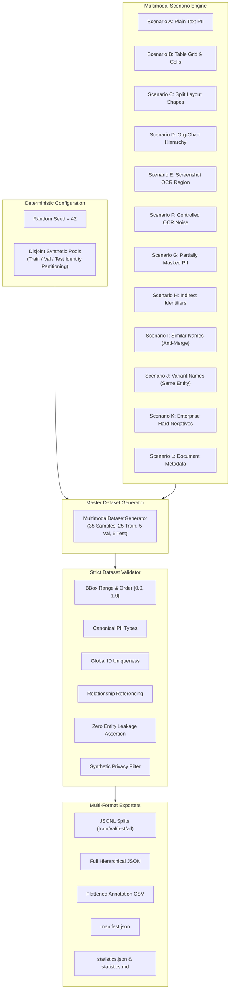

# Phase 5A Architecture & Specification: Multimodal Synthetic PII Dataset

## 1. System Architecture

Phase 5A establishes the multimodal dataset pipeline that feeds future multimodal and layout-aware detection models (Phase 5B).



---

## 2. Sample Schema & Annotation Examples

### 2.1 Example PII Annotation (JSON representation)
```json
{
  "annotation_id": "ann_train_0001",
  "sample_id": "sample_train_0001",
  "pii_type": "PERSON",
  "text": "Vikram Malhotra",
  "normalized_text": "Vikram Malhotra",
  "bbox": [0.05, 0.10, 0.25, 0.14],
  "page_or_slide": 1,
  "source": "native_text",
  "confidence_ground_truth": 1.0,
  "is_masked": false,
  "is_indirect": false,
  "is_partial": false,
  "entity_id": "entity_train_0001",
  "relationship_ids": [
    "rel_train_0001",
    "rel_train_0002"
  ]
}
```

### 2.2 Example Relationship Annotation
```json
{
  "relationship_id": "rel_train_0001",
  "sample_id": "sample_train_0001",
  "source_annotation_id": "ann_train_0001",
  "target_annotation_id": "ann_train_0002",
  "relationship_type": "SAME_ENTITY",
  "evidence": "Identified in same personal statement"
}
```

### 2.3 Example OCR Noisy Annotation
```json
{
  "annotation_id": "ann_train_0018",
  "sample_id": "sample_train_0006",
  "pii_type": "PAN",
  "text": "ABCPEI234K",
  "normalized_text": "ABCPE1234K",
  "bbox": [0.25, 0.20, 0.48, 0.26],
  "page_or_slide": 1,
  "source": "OCR",
  "confidence_ground_truth": 1.0,
  "is_masked": false,
  "is_indirect": false,
  "is_partial": false,
  "entity_id": null,
  "relationship_ids": []
}
```

---

## 3. Dataset Statistics Summary

- **Total Samples:** 35
  - Train: 25 samples (71.4%)
  - Validation: 5 samples (14.3%)
  - Test: 5 samples (14.3%)
- **Positive Samples:** 27 (77.14%)
- **Hard Negative Samples:** 8 (22.86% — strictly within required 20–30% target)
- **Total Ground-Truth PII Annotations:** 119
- **Total Layout Blocks:** 55
- **Total Explicit Relationships:** 34
- **Total Visual Regions:** 6

### Distribution by Canonical PII Type
| PII Type | Ground-Truth Count | Share |
| :--- | :--- | :--- |
| `PERSON` | 37 | 31.1% |
| `EMAIL` | 21 | 17.6% |
| `EMPLOYEE_ID` | 14 | 11.8% |
| `PHONE` | 12 | 10.1% |
| `SSN` | 7 | 5.9% |
| `IFSC` | 7 | 5.9% |
| `DIRECTOR_ID` | 4 | 3.4% |
| `CREDIT_CARD` | 3 | 2.5% |
| `PAN` | 3 | 2.5% |
| `ADDRESS` | 3 | 2.5% |
| `SECRET` | 2 | 1.7% |
| `BANK_ACCOUNT`| 1 | 0.8% |
| `CUSTOMER_ID` | 1 | 0.8% |
| `VENDOR_ID`   | 1 | 0.8% |
| `DOB`         | 1 | 0.8% |
| `PASSPORT`    | 1 | 0.8% |
| `PESEL`       | 1 | 0.8% |

---

## 4. Validation Rules (`validators.py`)

Every generated dataset is subjected to programmatic gating:
1. **Bounding Box Invariants:** $0.0 \le x_1 \le x_2 \le 1.0$ and $0.0 \le y_1 \le y_2 \le 1.0$.
2. **Canonical Type Enforcement:** All annotation types must belong to `CANONICAL_PII_TYPES`.
3. **Global ID Uniqueness:** Every `sample_id`, `annotation_id`, `block_id`, `relationship_id`, and `visual_id` is globally unique.
4. **Relationship Referencing:** Source and target IDs must exist within the same sample. `SAME_ENTITY` requires matching non-null `entity_id`.
5. **Zero Entity Leakage Assertion:** Disjoint set intersection test across train, val, and test partitions.
6. **Synthetic Privacy Enforcement:** Rejects non-synthetic email domains or unconstrained sensitive sequences.

---

## 5. Future Integration: Phase 5B Multimodal Detector

In **Phase 5B**, this dataset will serve as the validation and benchmarking foundation for a **layout-aware PII detector**.

Future detector capabilities will consume:
1. `blocks`: Multi-scale spatial bounding boxes and block hierarchy.
2. `text_content` + `source`: Distinguishing OCR noise from native typography.
3. `visuals`: Contextual clues from table structures, badges, and embedded screenshot containers.
4. `relationships`: Testing whether entity resolution modules correctly link disparate layout shapes (e.g. Org charts).
