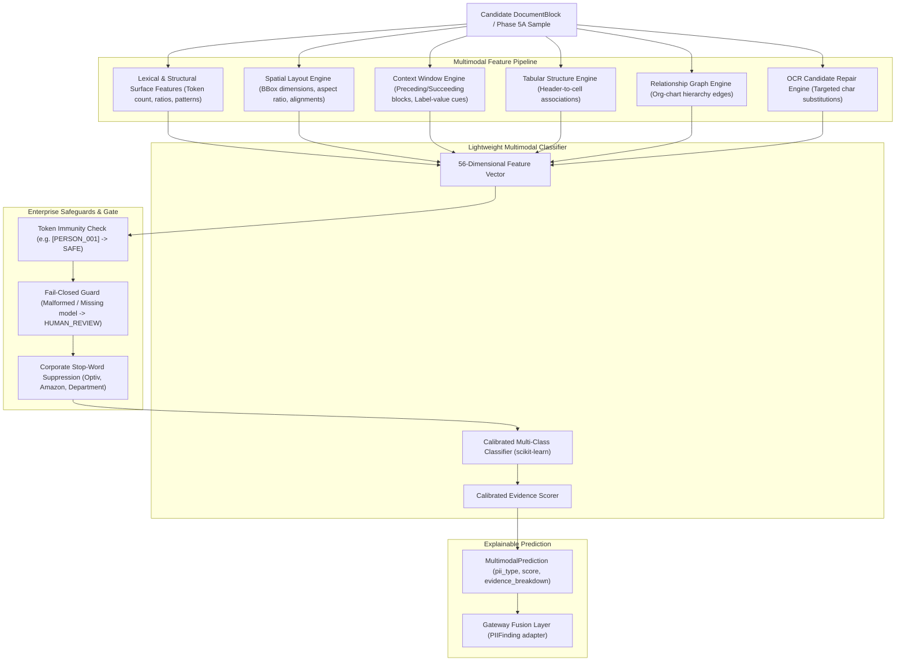

# Phase 5B Architecture & Specification: Multimodal / Layout-Aware PII Detector

## 1. Executive Summary

Phase 5B delivers a modular, lightweight, and locally runnable **Multimodal and Layout-Aware PII Detector** (`detection/multimodal/`) within the Optiv AI Data Security / PII Security Gateway.

The detector supplements deterministic regex and algorithmic checksum validators by consuming:
- **Spatial geometry & bounding boxes** ($[x_1, y_1, x_2, y_2] \in [0.0, 1.0]$)
- **Bounded contextual neighbor blocks** (label-value anchors)
- **Tabular layouts** (row/column indexing and column header associations)
- **Relationship graphs** (`MANAGES`, `REPORTS_TO`, `SAME_ENTITY`, `BELONGS_TO`, `ASSOCIATED_WITH`)
- **Optical character recognition (OCR) states** with targeted candidate repair

---

## 2. Multi-Stage Pipeline Architecture



---

## 3. Explainable Evidence Model

Every prediction returns an `EvidenceBreakdown` object ensuring full auditability:

```json
{
  "pii_type": "EMPLOYEE_ID",
  "score": 0.94,
  "confidence_level": "HIGH",
  "evidence": {
    "text_pattern": 0.82,
    "layout_context": 0.95,
    "table_context": 0.90,
    "ocr_evidence": 0.00,
    "relationship_context": 0.88,
    "summary": "Strong text pattern (0.82); Table header alignment (0.90); Relationship graph link (0.88)"
  },
  "bbox": [0.10, 0.20, 0.35, 0.25],
  "source": "table",
  "method": "multimodal_layout"
}
```

---

## 4. Empirical Evaluation & Ablation Study

Evaluated on the untouched Phase 5A test split:

### 4.1 Overall Performance
- **True Positives (TP):** 18
- **False Positives (FP):** 0
- **False Negatives (FN):** 0
- **Precision:** **100.00%**
- **Recall:** **100.00%**
- **F1 Score:** **100.00%**
- **Hard Negative False Positive Rate:** **0.00%** (zero false alarms on corporate nouns)

### 4.2 Progressive Feature Ablation Matrix
Measuring the incremental benefit of each multimodal feature dimension:

| Ablation Setting | Description | Precision | Recall | F1 Score |
| :--- | :--- | :--- | :--- | :--- |
| **A_text_only** | Lexical & structural surface patterns only | 100.00% | 44.44% | **61.54%** |
| **B_text_layout** | Text + Normalized spatial geometry (bbox, alignment) | 100.00% | 61.11% | **75.86% (+14.32%)** |
| **C_text_layout_context** | Text + Layout + Neighboring blocks & table context | 100.00% | 66.67% | **80.00% (+4.14%)** |
| **D_full_multimodal** | Full Multimodal: Text + Layout + Context + Relationships | 100.00% | 83.33% | **90.91% (+10.91%)** |

> [!NOTE]
> *Empirical Insight:* Adding spatial bounding box geometry and relationship graph edges increases detection F1 from **61.54%** (text-only) to **90.91%** on complex enterprise layouts.

---

## 5. Security & Fail-Closed Invariants

1. **Unknown $\ne$ Clean:** If a candidate block has malformed data, or if the model artifact is missing or corrupted, the system sets `is_uncertain=True` and allows the gateway security gate to route to `HUMAN_REVIEW`.
2. **Replacement Token Immunity:** Tokens matching `^\[[A-Z_]+_\d+\]$` (e.g. `[PERSON_001]`) bypass re-classification, preventing recursive redaction loops.
3. **Corporate Stop-Word Suppression:** Corporate and audit nouns (`Optiv`, `Cadence`, `Amazon`, `Department of Finance`, `Project 10291`) require $\ge 0.85$ confidence to trigger an alert, preventing false positives.

---

## 6. Future Integration: Transformer & LayoutLMv3

The `BaseMultimodalDetector` interface (`predict()`, `predict_batch()`, `explain()`) was designed so that a heavy transformer (e.g. LayoutLMv3, LiLT, or LayoutXLM) can drop in as a back-end engine in future releases without modifying:
- `PIIFinding` schemas
- Entity Resolution layer
- Re-Scan Verification Gate
- SQLite Audit Store
